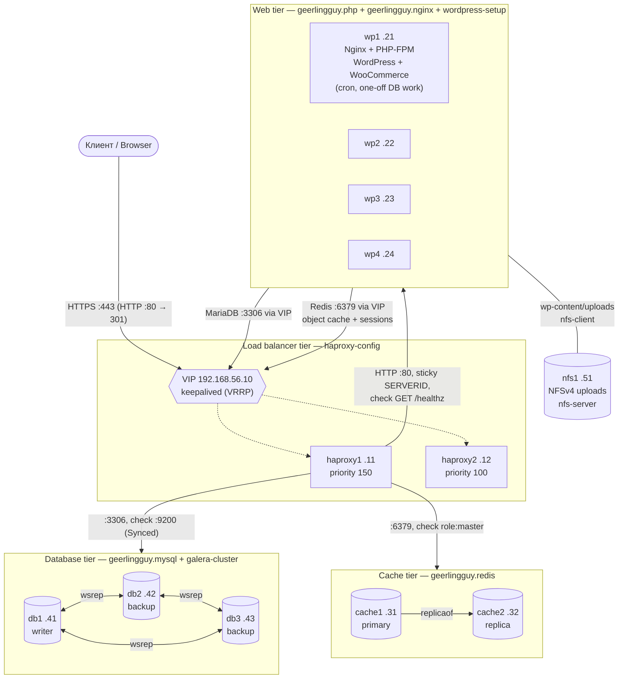
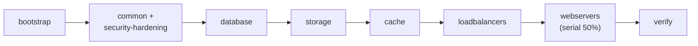

# Архитектура / Architecture

## Сообраќај / Request flow (production)

Staging (`192.168.57.0/24`) has the same structure with one HAProxy (no VIP),
2 web nodes and 1 Redis; Galera stays at 3 nodes because quorum needs them.

## Порти и firewall / Ports and firewall (UFW, `security-hardening`)

| Host group | Open port | Allowed from |
|---|---|---|
| all | 22/tcp | anywhere (lab) |
| loadbalancers | 80, 443 | anywhere |
| loadbalancers | 8404 (stats) | private subnet |
| loadbalancers | 3306, 6379 | web nodes |
| loadbalancers | all protocols (VRRP) | the other load balancer |
| wordpress | 80 | load balancers |
| galera | 3306 | load balancers, cluster members |
| galera | 4567, 4568, 4444 | cluster members |
| galera | 9200 (health) | load balancers |
| redis | 6379 | load balancers, Redis peers |
| storage | 2049 | web nodes |

## Deployment order (`site.yml`)

The load balancer tier comes **before** the web tier: WordPress reaches MariaDB
and Redis through HAProxy, so `wp core install` needs HAProxy to exist.
